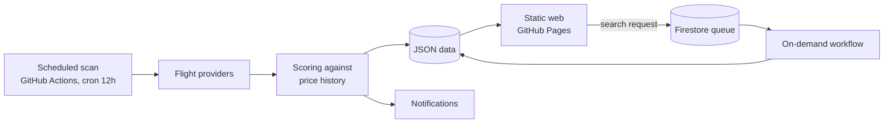

<p align="center">
  
</p>
<h1 align="center">TripFinder</h1>
<p align="center">
  <b>Weekend getaways from Madrid, below their usual price.</b><br>
  Scans flights, compares each fare with its route's history and works out what the whole trip costs.
</p>
<p align="center">
  <a href="https://tripfinder.es"><b>tripfinder.es</b></a> ·
  <a href="#features">Features</a> ·
  <a href="#how-it-works">How it works</a> ·
  <a href="#getting-started">Getting started</a> ·
  <a href="#documentation">Docs</a>
</p>
<p align="center">
  <a href="https://github.com/mateogsilvaa/tripfinder/actions/workflows/ci.yml"></a>
  
  
  
</p>

> The app and the detailed documentation are in Spanish.

## Features

- **Deals measured against history.** Fares are compared with past prices on the same route.
- **Useful hours.** Counts waking hours at the destination, so a cheap flight at bad times does not look like a bargain.
- **Full trip cost.** Combines per-person flights with group accommodation.
- **Custom search.** By city, country or continent, with exact or flexible dates.
- **Price alerts.** Follow a trip and opt in to notifications.
- **Interrail planner.** Builds a route with flights, trains and places to stay.
- **HOP.** Groups decide on a trip together with proposals, votes and chat.

## How it works



The web is static. Searches that need fresh prices are queued in Firestore and picked up by a workflow, which publishes
the result as JSON.

## Tech stack

| Layer | Technology |
|---|---|
| Engine | Python 3.12, one adapter per provider |
| Frontend | HTML, CSS and ES modules, no bundler. Installable as a PWA |
| Accounts and queue | Firebase Auth and Firestore |
| Scheduling | GitHub Actions |
| Hosting | GitHub Pages |
| Quality | ruff, pytest, oxlint, Playwright |

## Getting started

```bash
git clone https://github.com/mateogsilvaa/tripfinder.git
cd tripfinder
pip install -r requirements.txt
cp .env.example .env
```

Set `PYTHONPATH` to `src` (bash: `export PYTHONPATH=src`, PowerShell: `$env:PYTHONPATH = "src"`). Then run a scan that
writes nothing and sends no email:

```bash
python -m tripfinder scan-flights --dry-run
```

Or search for one trip:

```bash
python -m tripfinder search --dest Roma --max-price 120 --nights 2-3 --months 12
```

Airports, budgets and thresholds are set in [`config/watchlist.yml`](config/watchlist.yml).

## Tests

```bash
pip install -r requirements-dev.txt
ruff check .
python -m pytest -q
```

Frontend, after `npm install` and `npx playwright install chromium`:

```bash
npm run lint
npm run humo
```

## Project structure

| Path | Contents |
|---|---|
| `src/tripfinder/` | Providers, scoring, accommodation, notifications and CLI |
| `web/` | The static site |
| `config/` | Routes and thresholds |
| `data/` | Published results and price history |
| `tests/` | Python, web and Firestore rules tests |
| `tools/` | Page assembly, contrast audit and icons |

## Documentation

| Document | Covers |
|---|---|
| [Architecture](docs/ARCHITECTURE.md) | Components, workflows and design decisions |
| [Operation guide](docs/GUIA.md) | Setup, accounts, notifications and data sources |
| [Roadmap](docs/ROADMAP.md) | Done and planned work |

## Disclaimer

Prices come from third parties and can change at any time. Check the final price with the airline or the accommodation
before booking. TripFinder is an independent project.

## Author

Built by [Mateo González Silva](https://mateogsilvaa.es).
